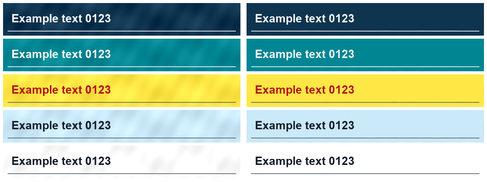

# Stop Crying

Reduce blotchy background colors around text in raster diagrams while protecting lettering and lines.

## Choose a treatment

| Visible defect | Treatment |
| --- | --- |
| Broad mottling in light chromatic fills near text | `clean_text.py --method background` (default intensity: strong) |
| Persistent mottling on intended solid dark, light, or white fields | `flatten_fields.py` with explicit field rectangles and target colors |
| Narrow bright fringe directly beside dark lettering | `clean_text.py --method rolling` |
| Simple local quadratic fill | `clean_text.py --method polynomial` |

The default filter transfers a weighted background correction and excludes dark/neutral fills. Even `strong` can leave broad mottling. Explicit flat fields replace the selected backgrounds more directly, including their intentional gradients. Neither method repairs spelling or glyph shapes.

## Flat-field example

Synthetic, generic text only. Left: mottled source. Right: explicit flat fields. This demonstrates the treatment on five fill colors; it is not a perceptual success score for arbitrary images.



[Source](examples/flat-fields-before.png) · [Result](examples/flat-fields-after.png) · [Field definitions](examples/flat-fields.json)

## Install and run

[Download the skill ZIP](packages/stop-crying.zip) and extract the `stop-crying` folder into your skills directory. Install dependencies in an isolated environment:

```sh
python3 -m venv .venv
.venv/bin/python -m pip install -r requirements.txt
```

For an intended flat diagram, inspect the source, select surface rectangles, and choose target colors:

```sh
.venv/bin/python scripts/flatten_fields.py input.png output/flat.png --fields fields.json
```

See [field format, algorithm, and limitations](references/flat-fields.md). No OCR is needed for this mode. Low-contrast artwork can be mistaken for background; keep unrelated elements outside selected fields.

For the original background filter, use OCR proposals matching the source dimensions:

```sh
mkdir -p output
swiftc -module-cache-path output/swift-cache scripts/detect_text.swift -o output/detect_text
output/detect_text input.png output/text-boxes.json
.venv/bin/python scripts/clean_text.py input.png output/cleaned.png --boxes output/text-boxes.json
```

The OCR helper uses macOS Vision; other systems can supply the same JSON box format documented in [SKILL.md](SKILL.md). Dependencies and [background filtering details](references/background.md) apply to this mode.

Each mode saves a separate PNG and diagnostics. Compare the same source-coordinate crops at 3×–5× nearest-neighbor enlargement and normal size. Inspect broad fills between letters as well as small text and boundaries. Core equality or changed-pixel counts alone do not establish visual quality.

## Validate

```sh
.venv/bin/python scripts/selftest_fields.py --font /path/to/bold.ttf --output-dir output/fields-test
.venv/bin/python scripts/selftest_background.py --font /path/to/bold.ttf --output-dir output/background-test
```

The synthetic field test checks background restoration and preservation invariants. The separate background test covers the original filter. Rejected visual results require inspection and a treatment change, not an unsupported claim that a stronger preset succeeded.

## License

[MIT](LICENSE).
